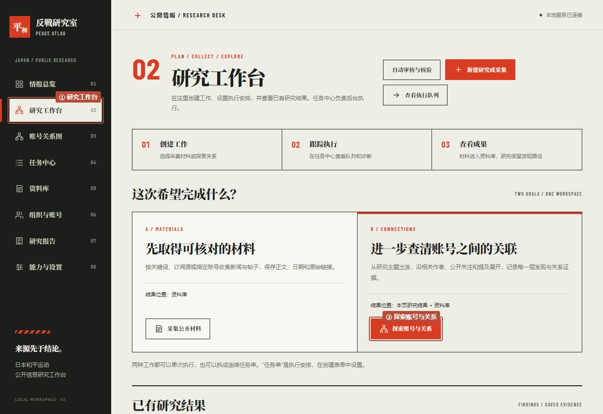
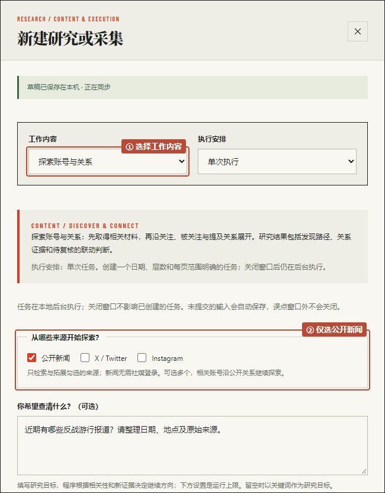
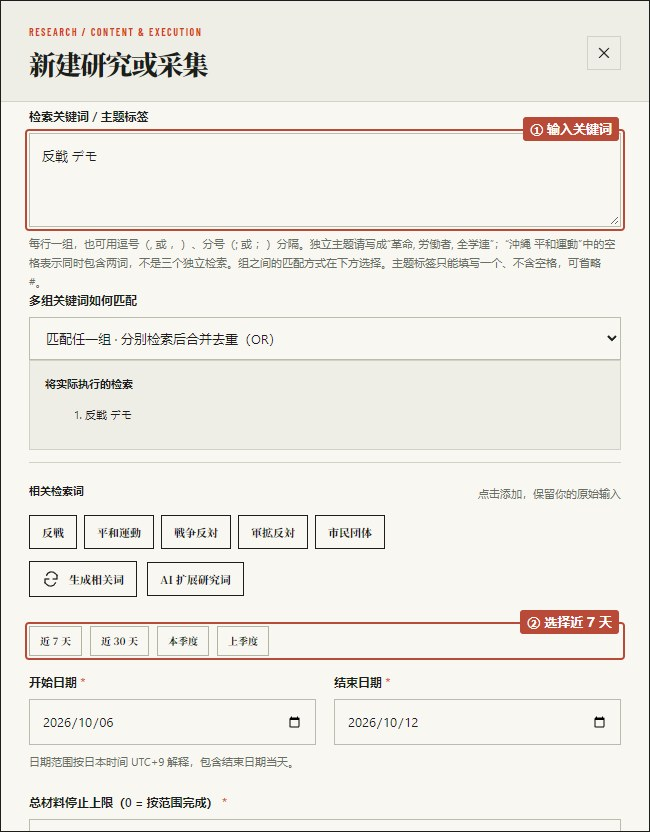
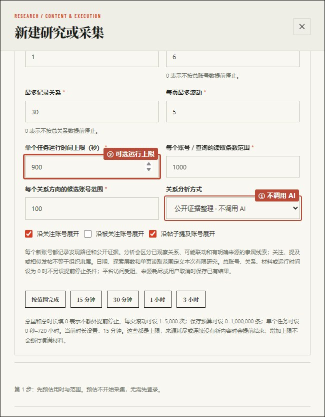
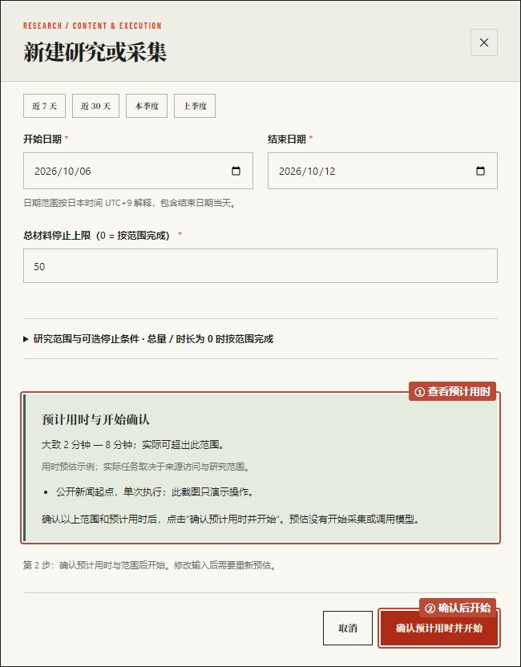
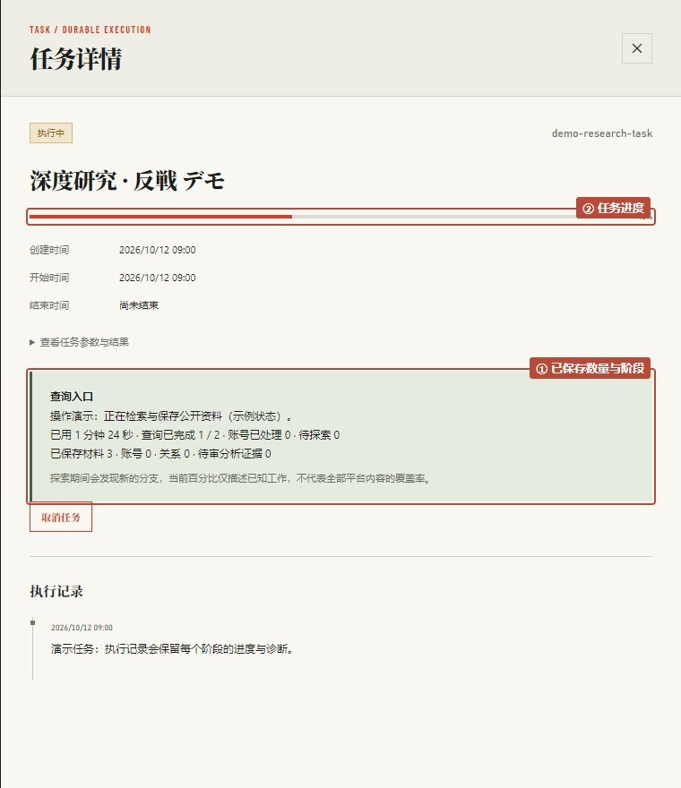
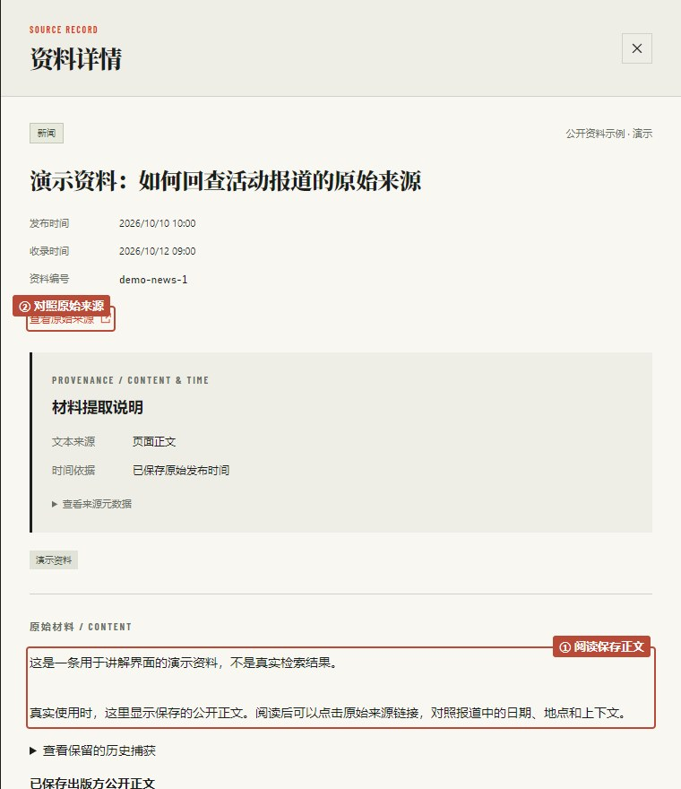
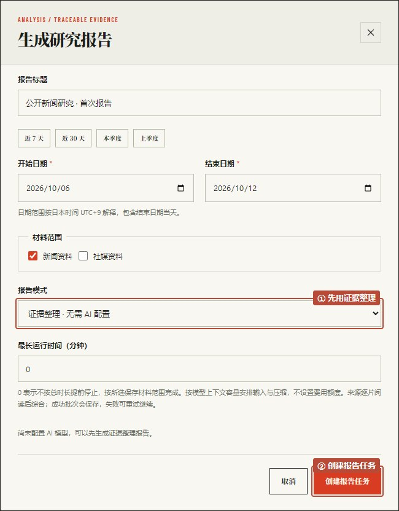
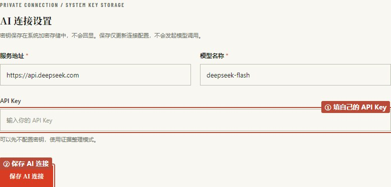

# 图文快速上手

从一个小范围新闻研究开始，熟悉“创建工作 → 确认范围 → 跟踪任务 → 回查资料 → 生成报告”。本示例不要求社媒登录，可以先不配置 AI。

先从[项目首页](../README.md)下载对应系统的安装包：Windows 双击 `.exe`，Apple Silicon Mac 双击 `.pkg`。安装后打开 PEACE ATLAS。

**以下截图来自当前软件界面，使用隔离的演示资料。红框和编号标出操作位置；图中的数量、任务状态和预计用时用于讲解，以自己实际执行的结果为准。图片可以打开查看大图。**

## 1. 找到创建入口

点击左侧 **“研究工作台”**，再点击右侧卡片中的 **“探索账号与关系”**。

- **采集公开材料**：先保存新闻和帖子，结果到资料库查看。
- **探索账号与关系**：围绕主题进一步探索公开线索，同时保存材料和发现路径。

## 2. 选择来源，输入主题

在“新建研究或采集”窗口中：

1. **工作内容**选择“探索账号与关系”。
2. **执行安排**选择“单次执行”。
3. **从哪些来源开始探索？**只勾选“公开新闻”。新闻无需社媒登录。
4. “你希望查清什么？”可以留空，或填写：`近期有哪些反战游行报道？请整理日期、地点及原始来源。`

向下滚动，填写：

- **检索关键词 / 主题标签**：`反戦 デモ`。
- **日期**：点击“近 7 天”。日期范围按日本时间 UTC+9 解释。

`反戦 デモ` 中的空格表示同时包含两个词。想分别检索多个主题，可以每行写一组，或用逗号分隔，再看“将实际执行的检索”是否符合预期。

## 3. 设置一个小范围示例

把日期下方的 **“总材料停止上限”**设为 `50`，然后展开 **“研究范围与可选停止条件”**。第一次可以使用下表；没有列出的参数先保持默认。

| 参数 | 起步示例 | 用途 |
| --- | --- | --- |
| 向下探索层数 | `1` | 先熟悉第一层发现与材料保存。 |
| 最多探索账号 | `6` | 控制首次探索规模。新闻研究可能没有账号线索。 |
| 最多记录关系 | `30` | 限定本次记录的关系数量。 |
| 总材料停止上限 | `50` | 本次保存材料的总上限，不保证一定取得 50 条。 |
| 每页最多滚动 | `5` | 社媒页面的读取范围；仅新闻示例可保持默认。 |
| 单个任务运行时间上限（秒） | `900` | 起步示例最多运行 15 分钟，也可使用下方快捷按钮。 |
| 关系分析方式 | **公开证据整理 · 不调用 AI** | 先跑通流程，不调用付费模型。 |

这些数值只是起步示例，可以按研究需要放宽。总账号、关系、材料和运行时间设为 `0` 时，不按对应总量提前停止；任务仍遵循所选日期、探索层数、单页读取范围及平台实际可访问范围。

## 4. 预估并确认启动

1. 点击表单底部 **“预估用时与范围”**。
2. 查看预计用时及说明。预估不会开始采集，也不会调用模型。
3. 确认后点击 **“确认预计用时并开始”**。

预计时间是范围估算，实际可能更长。修改关键词、来源、日期或范围后，重新预估再确认。

## 5. 在任务中心跟踪执行

创建后会进入 **“任务中心”**并打开任务详情。在这里查看：

- **任务状态与进度条**：排队、执行中、完成或失败。
- **当前阶段和已保存数量**：知道任务正在做什么，以及已经保留了多少材料。
- **执行记录与诊断**：来源无法访问、没有匹配结果或模型错误会在这里说明。

关闭详情窗口不影响已创建的后台任务；需要停止时点击“取消任务”。失败后先看错误原因，再使用详情中提供的重试或继续入口。

## 6. 回查保存的原文

点击左侧 **“资料库”**，再点击一条资料的标题打开“资料详情”。先阅读正文，再通过 **“查看原始来源”**对照日期、地点和上下文。

如果新闻记录只有检索摘要，可在详情中使用“读取公开原文”补充正文。Google News 等聚合器资料需先填写 **“出版方原文地址（聚合器资料需填写）”**，再开始读取；无法读取时，原因会保留在任务中。

新闻起点可能只取得文章，没有账号或关系边；先查看资料库。发现公开账号线索后，再到研究工作台查看相应研究结果，或到账号关系图探索已经保存的联系。

## 7. 生成第一份报告

点击左侧 **“研究报告” → “生成报告”**：

1. 报告标题可自填，也可以留空。
2. 选择与研究一致的日期范围。本例点击“近 7 天”。
3. 材料范围勾选“新闻资料”；仅新闻示例可以取消“社媒资料”。
4. 报告模式选择 **“证据整理 · 无需 AI 配置”**。
5. 点击 **“创建报告任务”**，到任务中心查看执行；完成后回到研究报告页面阅读或下载。

报告只使用资料库中所选日期的保存材料。先确认资料库已有材料，再生成报告；重要研究可以在“能力与设置”中备份。

## 使用 DeepSeek 分析（可选）

需要模型进一步分析时，点击左侧 **“能力与设置”**，滚动到 **“AI 连接设置”**：

| 字段 | 填写方式 |
| --- | --- |
| 服务地址 | DeepSeek 连接默认使用 `https://api.deepseek.com`。 |
| 模型名称 | 保持当前默认 `deepseek-flash`，或填写自己服务提供方支持的模型。 |
| API Key | 填写自己从服务提供方取得的有效密钥；模型账户需要可用额度。 |

点击 **“保存 AI 连接”**。保存配置本身不会调用模型；密钥不会回显。已有密钥时，**未勾选“清除已保存的密钥”且 API Key 留空**，会保留原密钥。

配置好后，可以在新研究中选择“自动 · 有 AI 时增强分析”或“AI 分析 · 使用已配置模型”；生成报告时选择“AI 分析”。需要主动工具调查时，在报告的“AI 调查方式”中选择“DSH 工具分析 · 主动查证与比较”。

## 接下来可以做什么

- **研究 X 或 Instagram**：先在“能力与设置”验证对应平台会话，再在新任务中勾选来源。
- **探索账号关系**：到账号关系图拖拽、筛选关注方向，点击节点查看已保存依据；类型不合适时可手动更正。
- **查看活动分布**：日本地图显示所选日期范围内已核对、已定位活动的地区数量与占比。
- **保存研究**：备份保留研究资料；不相关内容可通过资料清理进入回收站，按需恢复。
- **交给外部 Agent**：按[Agent 接入说明](AGENT_INTEGRATION.md)导出授权连接并配置 Skill / CLI。

更多参数与各页面的完整说明见[操作说明书](USER_MANUAL_20261010_AGENT.md)，下载安装入口见[项目首页](../README.md)。
