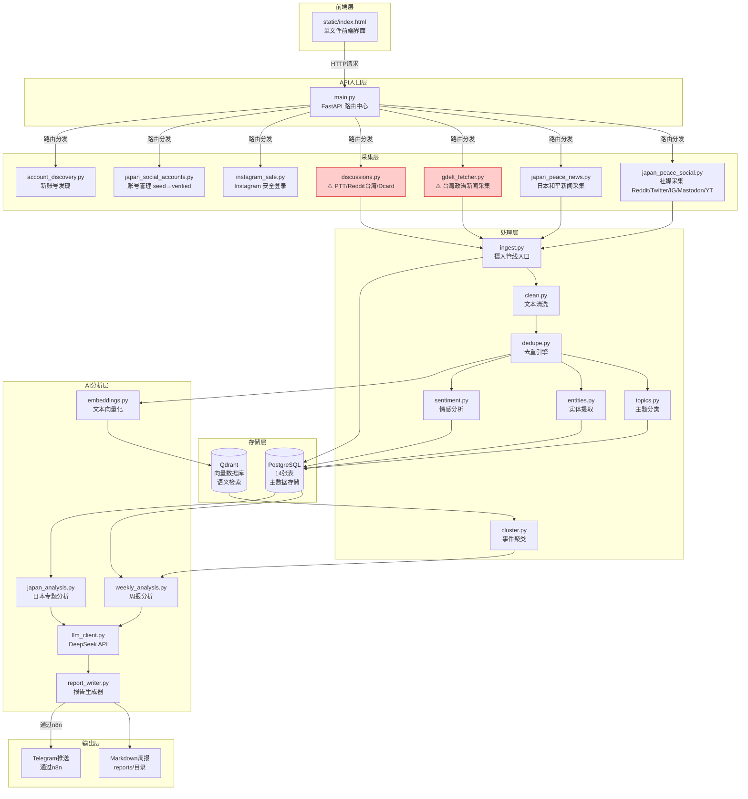
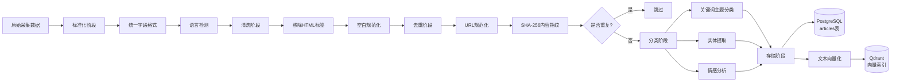
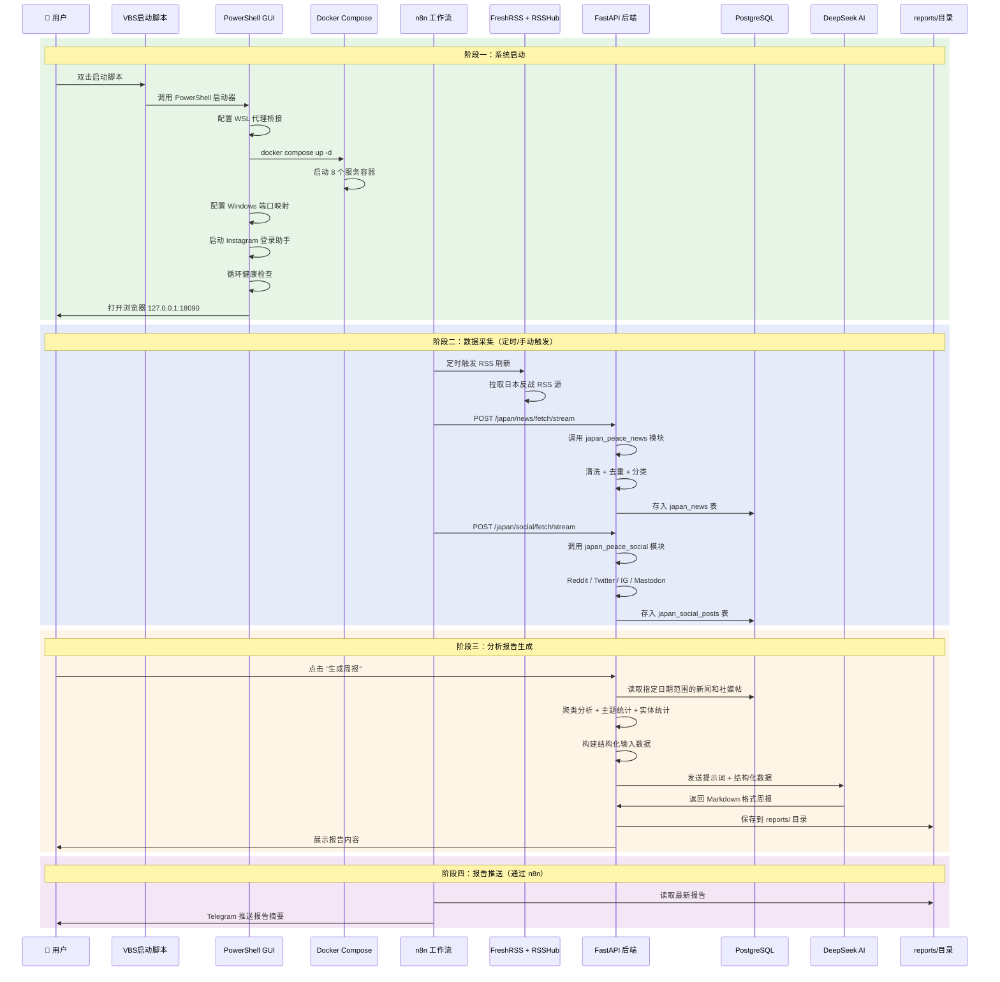

# japan-antiwar-intel 项目分析报告

> 分析日期：2026-05-16
> 项目根目录：`C:\Users\wwx\Documents\New project 4\japan-antiwar-intel`

---

## 1. 项目概览

### 1.1 这是什么项目

**"日本反战运动公开情报系统"** — 一个自动从各种公开网络来源收集日本反战/和平运动相关信息、然后用 AI 进行分析并生成周报的系统。

简单说，这个项目做三件事：
1. **找信息** — 从新闻网站、社交媒体（Twitter/X、Reddit、Instagram 等）、RSS 订阅源自动抓取与日本反战相关的内容
2. **分析信息** — 用 AI（DeepSeek 大语言模型）分析这些内容，包括判断主题、提取关键人物/组织、分析情感倾向
3. **写报告** — 自动生成 Markdown 格式的周报，汇总一周内的反战运动动态

### 1.2 项目规模

| 维度 | 数值 |
|------|------|
| Python 代码文件 | ~22 个核心模块 |
| 总代码行数 | 约 12,000+ 行 |
| YAML 配置文件 | 6 个 |
| Docker 容器服务 | 8 个 |
| 数据库表 | 14 张 |
| 测试文件 | 7 个（50+ 测试用例） |
| LLM 提示词文件 | 2 个 |
| 辅助脚本 | 10 个 |

### 1.3 项目来源推测

**【推测】** 这个项目很可能是从一个"台湾政治情报收集分析系统"改造而来。整个代码库中仍大量存在原台湾项目的内容。本报告的核心任务之一就是系统性地找出这些残留内容。

---

## 2. 技术栈与依赖说明

这里用通俗方式解释项目使用的各项技术，以及它们在本项目中起什么作用。

### 2.1 编程语言和运行环境

| 技术 | 通俗解释 | 在本项目中的作用 |
|------|---------|----------------|
| **Python 3.12** | 一种通用编程语言，语法简洁，适合写数据处理和网络抓取程序 | 所有后端代码都用 Python 写的 |
| **Docker** | 一种"打包"技术，把程序及其所有依赖打包成标准化的盒子（叫"容器"），在任何电脑上都能一致地运行 | 项目用 Docker 把各个服务封装起来，不需要手动安装各种软件 |
| **Docker Compose** | 管理多个 Docker 容器的工具，可以一键启动/停止整个系统 | 定义了 8 个服务（数据库、RSS阅读器、爬虫等）如何协作 |

### 2.2 后端框架

| 技术 | 通俗解释 | 在本项目中的作用 |
|------|---------|----------------|
| **FastAPI** | Python 的一个 Web 框架，用来写网站/API 后端。可以理解为"接收网页请求并返回数据的程序骨架" | 整个系统的 API 入口，前端页面通过它来调用后端功能 |
| **Uvicorn** | 运行 FastAPI 的服务器程序 | 让 FastAPI 应用能被外部访问 |

### 2.3 数据库

| 技术 | 通俗解释 | 在本项目中的作用 |
|------|---------|----------------|
| **PostgreSQL** | 一种传统的关系型数据库（像 Excel 表格一样按行列存储） | 存储新闻文章、社交媒体帖子、分析结果、账号信息等所有结构化数据 |
| **Qdrant** | 一种"向量数据库"，存的是 AI 把文字转成的数学向量 | 用于找"语义相似"的文章（不只是关键词匹配，而是理解意思相近） |
| **Redis** | 一种高速内存缓存数据库 | 给 RSSHub 做缓存，减少重复请求外部网站 |

### 2.4 爬虫/采集工具

| 技术 | 通俗解释 | 在本项目中的作用 |
|------|---------|----------------|
| **httpx** | Python 的 HTTP 请求库（向网站发请求拿内容的工具） | 用于采集 Reddit RSS、Mastodon API、YouTube RSS 等需要发 HTTP 请求的源 |
| **feedparser** | 解析 RSS/Atom Feed 的库（RSS 是网站用来发布更新的标准格式） | 解析各种新闻网站的 RSS 订阅源 |
| **BeautifulSoup4** | HTML 网页解析库（从网页源代码中提取文字/链接） | 用于在没有 RSS 的情况下直接从 HTML 页面提取内容 |
| **Playwright** | 浏览器自动化工具（可以像真人一样操作浏览器） | 只在采集 Instagram 时使用（Instagram 需要浏览器环境才能访问） |
| **curl_cffi** | 具有浏览器指纹模拟的 HTTP 库（让请求看起来更像来自真实浏览器） | 用于绕过 Dcard 等网站的 Cloudflare 防护 |
| **twikit** | Twitter/X 的 API 封装库 | 用于采集 Twitter/X 上的内容 |

### 2.5 AI / 大语言模型

| 技术 | 通俗解释 | 在本项目中的作用 |
|------|---------|----------------|
| **DeepSeek API** | 国产大语言模型服务（类似 ChatGPT） | 用来分析采集到的内容、生成周报摘要、分类主题 |
| **Embedding（嵌入向量）** | 把一段文字转换成一串数字，语义相近的文字数字也相近 | 用来在 Qdrant 中做语义相似度搜索 |

### 2.6 其他支撑服务

| 服务 | 通俗解释 | 在本项目中的作用 |
|------|---------|----------------|
| **n8n** | 可视化的"自动化工作流"工具（像拼积木一样编排任务） | 负责定时触发采集、分析、推送等自动化流程 |
| **FreshRSS** | RSS 阅读器（订阅和管理 RSS 源） | 集中管理所有 RSS 订阅源，20 分钟自动刷新一次 |
| **RSSHub** | "RSS 生成器"（给没有 RSS 的网站生成 RSS 订阅地址） | 把不提供 RSS 的网站（如政府公告页）转成 RSS 格式 |
| **changedetection.io** | 网页变更监控工具 | 监控那些不提供 RSS 的静态网页，内容变了就通知 |

---

## 3. 按功能分类的文件树摘要

把所有文件按功能分组，方便快速定位。

```
japan-antiwar-intel/
│
├── 🚀 启动入口（6个文件）
│   ├── 启动日本反战情报系统.vbs        # Windows 一键启动（隐藏窗口）
│   ├── 启动社媒采集.bat                # 社媒采集循环启动
│   ├── scripts/Start-JapanAntiwarIntel.ps1  # PowerShell 主启动器（GUI）
│   ├── scripts/Start-InstagramLoginHelper.ps1 # IG 登录助手启动
│   └── docker-compose.yml            # Docker 编排文件（定义8个服务）
│
├── ⚙️ 环境变量与依赖
│   ├── .env                          # 实际环境变量（含密码/密钥）
│   ├── .env.example                  # 环境变量模板
│   ├── analysis-worker/requirements.txt  # Python 依赖清单
│   └── analysis-worker/Dockerfile    # 后端容器构建文件
│
├── 📡 后端核心代码（22个模块，位于 analysis-worker/app/）
│   │
│   ├── 🏠 入口与路由
│   │   └── main.py                   # FastAPI 主入口，定义所有 API 路由
│   │
│   ├── 🕷️ 数据采集模块
│   │   ├── gdelt_fetcher.py          # GDELT + Google News + 固定RSS 三层新闻采集
│   │   ├── japan_peace_news.py       # 日本和平新闻专项采集
│   │   ├── japan_peace_social.py     # 日本社媒采集核心（Reddit/Twitter/IG/Mastodon/YouTube）
│   │   ├── discussions.py            # 论坛讨论采集（PTT/Reddit/Dcard）
│   │   ├── instagram_safe.py         # Instagram 安全登录与采集
│   │   ├── japan_social_accounts.py  # 社媒账号管理（seed→candidate→verified 工作流）
│   │   └── account_discovery.py      # 公开账号发现（Bing + Google News）
│   │
│   ├── 🧹 数据处理模块
│   │   ├── ingest.py                 # 文章摄入管线（标准化→清洗→去重→分类→存入）
│   │   ├── clean.py                  # 文本清洗和语言检测
│   │   ├── dedupe.py                 # URL 归一化 + SHA-256 内容指纹去重
│   │   ├── topics.py                 # 基于 YAML 配置的关键词主题分类
│   │   ├── entities.py               # 基于 YAML 配置的实体提取（支持别名）
│   │   └── sentiment.py              # 规则情感分析（中/英/日文情感词典）
│   │
│   ├── 🤖 AI 分析模块
│   │   ├── llm_client.py             # DeepSeek API 客户端
│   │   ├── embeddings.py             # 文本嵌入向量 API
│   │   ├── cluster.py                # 文章事件聚类
│   │   ├── weekly_analysis.py        # 周报分析逻辑
│   │   ├── japan_analysis.py         # 日本专题分析管线
│   │   ├── report_writer.py          # Markdown/HTML 报告生成器
│   │   └── async_research.py         # 异步研究任务队列
│   │
│   ├── 🗺️ 辅助模块
│   │   ├── japan_geo.py              # 日本地名归一化
│   │   └── models.py                 # 数据模型定义（Pydantic）
│   │
│   ├── 🗄️ 数据库模块
│   │   ├── db.py                     # PostgreSQL 连接管理
│   │   └── qdrant_store.py           # Qdrant 向量数据库客户端
│   │
│   └── 🖥️ 前端
│       └── static/index.html         # 单文件前端界面（日本反战主题）
│
├── 📋 配置文件（6个 YAML，位于 analysis-worker/config/）
│   ├── sources.yml                   # ⚠️ 台湾新闻源（24个台湾媒体）
│   ├── topics.yml                    # ⚠️ 台湾政治主题关键词
│   ├── entities.yml                  # ⚠️ 台湾政治人物/机构实体
│   ├── japan_peace_topics.yml        # ✅ 日本和平运动10大主题
│   ├── japan_peace_entities.yml      # ✅ 日本和平相关实体
│   └── japan_social_accounts_seed.yml # ✅ 日本社媒种子账号（32个）
│
├── 🧠 AI 提示词（2个文件，位于 prompts/）
│   ├── weekly_deep_analysis_prompt.md       # ⚠️ "台湾政治动向周报" 提示词
│   └── japan_antiwar_analysis_prompt.md     # ✅ "日本反戦・平和運動公開情報週報" 提示词
│
├── 🗃️ 数据库初始化
│   └── analysis-worker/sql/init.sql  # 14 张表的建表语句 + 台湾源种子数据
│
├── 🧪 测试文件（7个，位于 analysis-worker/tests/）
│   ├── test_japan_peace.py           # 日本反战测试（30+ 用例）
│   ├── test_discussions.py           # 论坛采集测试
│   ├── test_dedupe.py                # 去重测试
│   ├── test_topics.py                # 主题分类测试
│   ├── test_sentiment.py             # 情感分析测试
│   ├── test_report_writer.py         # 报告生成测试
│   └── test_weekly_report.py         # 周报测试
│
├── 🔧 辅助脚本（位于 scripts/）
│   ├── Start-JapanAntiwarIntel.ps1   # Windows GUI 主启动器
│   ├── Start-InstagramLoginHelper.ps1
│   ├── check_services.ps1 / .sh      # 健康检查
│   ├── trigger_weekly_analysis.ps1/.sh # 手动触发周报
│   ├── windows_port_bridge.py        # Windows 端口桥接
│   ├── wsl_proxy_bridge.py           # WSL 代理桥接
│   └── instagram_login_helper.py     # Instagram 登录辅助
│
├── 📊 RSS 与工作流
│   ├── feeds/japan-antiwar-starter.opml  # 42个日本和平相关RSS源
│   ├── rsshub/Dockerfile             # RSSHub + Playwright 扩展
│   └── n8n-workflows/README.md       # n8n 工作流设置说明
│
└── 📝 其他
    ├── README.md                     # 项目说明文档（中文）
    └── reports/.gitkeep              # 报告输出目录占位文件
```

---

## 4. 启动入口分析

项目有 **5 类启动入口**，分别对应不同场景：

### 4.1 一键 GUI 启动器（推荐方式）

**入口**: `启动日本反战情报系统.vbs`

```
用户双击 VBS 文件
    ↓
VBS 调用 scripts/Start-JapanAntiwarIntel.ps1（PowerShell GUI）
    ↓
GUI 启动器执行以下步骤：
    1. 启动 WSL 代理桥接（让 Docker 容器能走 Windows 代理上网）
    2. 执行 docker compose up -d（启动全部 8 个服务）
    3. 启动 Windows 端口映射（把容器端口映射到 Windows 端口）
    4. 启动 Instagram 登录助手
    5. 循环健康检查直到所有服务就绪
    6. 打开浏览器访问 http://127.0.0.1:18090
```

### 4.2 社媒采集专用入口

**入口**: `启动社媒采集.bat`

```batch
docker compose run --rm analysis-worker python standalone_social_collector.py --loop --interval 600
```

这个脚本启动一个独立的社媒采集器，不依赖 FastAPI 服务。它会每 10 分钟循环采集一次社媒内容。

### 4.3 Docker Compose 命令行入口

**入口**: `docker compose up -d`（在项目根目录执行）

启动所有 8 个服务。其中 `analysis-worker` 容器通过以下命令启动后端：

```dockerfile
CMD uvicorn app.main:app --host 0.0.0.0 --port 8090
```

启动文件链：
```
uvicorn 启动
  → app/main.py 中的 FastAPI app 实例
    → 注册所有 API 路由
    → 加载各模块
    → 开始监听 8090 端口
```

### 4.4 n8n 工作流定时触发

n8n 服务运行在 `http://127.0.0.1:5782`，可以在其中设置定时工作流来：
- 定时调用 `/gdelt/fetch/stream` 抓取新闻
- 定时调用 `/japan/news/fetch/stream` 抓取日本新闻
- 定时调用 `/api/japan/social/fetch` 抓取社媒
- 定时调用 `/analyze/weekly/stream` 生成周报
- 通过 Telegram 发送报告

### 4.5 脚本手动触发

| 脚本 | 功能 |
|------|------|
| `scripts/trigger_weekly_analysis.ps1` | 手动触发周报生成（POST 到 `/analyze/weekly`） |
| `scripts/check_services.ps1` | 检查所有服务健康状态 |
| `scripts/Start-InstagramLoginHelper.ps1` | 单独启动 IG 登录助手 |

### 4.6 前端入口

项目只有一个前端页面：`analysis-worker/app/static/index.html`。它通过 FastAPI 的静态文件路由提供服务：

- `/` → 优先返回 `japan-index.html`（**不存在**【事实】），降级返回 `index.html`
- `/taiwan` → 返回 `index.html`（**明确标记为"旧台湾页面"**）

前端页面包含两个 Tab：
- **信息检索** Tab：新闻检索、社媒账号管理、社媒抓取、已抓取内容浏览
- **AI 总结分析** Tab：周报生成、历史报告浏览、日本专题分析

---

## 5. 各模块功能说明

### 5.1 数据采集模块

#### gdelt_fetcher.py（新闻采集核心，497行）
**作用**: 从三个层次获取新闻数据
1. **GDELT API**（第一层）：GDELT 是一个全球新闻索引数据库，可以从里面搜索全球新闻
2. **Google News RSS**（第二层）：当 GDELT 不够时，用 Google News 的 RSS 搜索补充
3. **固定 RSS 源**（第三层）：当上面两种方式都不够时，直接读取预设的 RSS 源

⚠️ **当前状态**: 这个模块的**所有查询关键词都是台湾政治相关**（如"赖清德""台湾立法院""台海"等），内置的 RSS 源也都是台湾媒体（中央社、自由时报、Taipei Times 等）。

#### japan_peace_news.py（日本新闻采集，593行）
**作用**: 专门为日本反战主题设计的新闻采集模块。包含 8 个日本和平相关 RSS 源和 8 个 GDELT 主题查询。这是后期新增的日本模块。

#### japan_peace_social.py（日本社媒采集核心，2220行）
**作用**: 从多个社交媒体平台采集日本反战相关内容。支持的平台：
- **Reddit**: 通过 RSS/HTML 抓取日文子版块（不用 API key）
- **Twitter/X**: 通过 Nitter RSS 镜像抓取（不用 API）
- **Instagram**: 通过 Playwright 浏览器模拟（需登录）
- **Mastodon**: 通过公开 API 获取
- **YouTube**: 通过 RSS Feed
- **RSSHub**: 通过第三方 RSS 生成器
- **Bing RSS**: 作为降级方案

#### discussions.py（论坛采集，2657行）
**作用**: 从网络论坛抓取公众讨论。支持的平台：
- **PTT**: 台湾最大的 BBS 论坛
- **Reddit**: 预设搜索 `r/taiwan`、`r/Taiwanese` 等子版块
- **Dcard**: 台湾大学生论坛

⚠️ **当前状态**: 这个模块的默认搜索关键词全部是台湾政治相关（"台湾政治""Taiwan politics""台海""两岸"等），Reddit 子版块预设为 `taiwan`。这些都不符合日本反战项目的目标。

#### instagram_safe.py（Instagram 安全采集，401行）
**作用**: 用 Playwright 模拟真实浏览器访问 Instagram，通过模拟真人操作来规避风控。包含登录状态持久化和速率限制。

#### account_discovery.py（账号发现，221行）
**作用**: 通过 Bing 和 Google News 公开搜索来"发现"新的社媒账号。自动搜索日本反战相关关键词，找出可能相关的账号。

#### japan_social_accounts.py（账号管理，607行）
**作用**: 管理社交媒体账号的数据库。实现了三阶段验证流程：
- **seed**（种子）: 手工添加或自动发现的账号
- **candidate**（候选）: 经过初步筛选值得验证的账号
- **verified**（已验证）: 已经确认是相关账号

### 5.2 数据处理模块

#### ingest.py
**作用**: "文章摄入管线"的入口。接收采集到的文章，依次执行标准化、清洗、去重、分类、嵌入向量计算、然后存入数据库。

#### clean.py
**作用**: 清洗文本内容——移除 HTML 标签、统一空白字符、检测语言（中文/日文/英文）。

#### dedupe.py
**作用**: 去重引擎。用两种方式判断文章是否重复：
1. URL 规范化（把相似的 URL 归并为同一个）
2. SHA-256 内容指纹（计算文章内容的哈希值，完全相同的内容算一篇）

#### topics.py
**作用**: 主题分类器。根据 YAML 配置文件中的关键词列表，判断一篇文章属于哪个主题。支持中文、英文、日文关键词。

#### entities.py
**作用**: 实体提取器。从文章中提取人物、政党、机构、外部实体等命名实体，支持别名匹配（如 "赖清德" = "Lai Ching-te" = "President Lai"）。

#### sentiment.py
**作用**: 情感分析器。基于内置的中文/英文/日文情感词典，判断文本的情感倾向（积极/愤怒/焦虑/讽刺等）。

### 5.3 AI 分析模块

#### llm_client.py
**作用**: DeepSeek API 的封装层。负责与 AI 模型通信，发送提示词和分析数据，接收 AI 生成的分析结果。如果 API Key 未设置，会降级到规则引擎。

#### embeddings.py
**作用**: 调用嵌入向量 API，将文本转换为数学向量，存入 Qdrant 向量数据库。

#### cluster.py
**作用**: 将相似的文章聚合成"事件组"，使用 SequenceMatcher + 余弦相似度两种算法。

#### weekly_analysis.py
**作用**: 周报分析的核心逻辑。包含两个版本：
- `analyze_weekly()`: 旧版台湾周报分析
- `analyze_japan_weekly()`: 新版日本反战周报分析

#### japan_analysis.py（408行）
**作用**: 日本专题分析管线。支持按周/季度周期分析日本反战运动态势。

#### report_writer.py（669行）
**作用**: 报告生成器。包含两个版本的报告模板：
- 旧版 `fallback_report()` 生成"台湾政治动向周报"
- 新版 `japan_fallback_report()` 生成"日本反戦態勢報告"

#### async_research.py（214行）
**作用**: 异步研究任务队列。支持创建后台研究任务，异步执行后返回结果。

### 5.4 辅助模块

#### japan_geo.py（155行）
**作用**: 日本地名归一化。把各种变体的日本地名统一为标准名称（如 "東京" = "Tokyo" = "东京"）。

#### models.py
**作用**: 定义所有 API 请求/响应的数据结构（Pydantic 模型），包含约 30+ 个数据模型，覆盖采集请求、分析请求、账号管理、报告查询等。

---

## 6. 模块关系图



> 图中红色标记的模块（gdelt_fetcher.py、discussions.py）包含大量台湾项目残留内容。

---

## 7. 数据流分析

### 7.1 数据来源全景

```
数据来源分类：

📰 新闻来源
├── GDELT API（全球新闻索引，⚠️ 当前查询词全是台湾政治）
├── Google News RSS（多语种搜索，⚠️ 默认搜索台湾政治）
├── 固定 RSS 源（⚠️ 默认 RSS 列表全是台湾媒体）
├── 日本和平新闻 RSS（✅ 8个日本反战主题源）
└── changedetection.io 网页监控（台湾政府网站页面）

💬 社交媒体来源
├── Twitter/X（通过 Nitter RSS，搜索日本反战关键词 ✅）
├── Reddit（⚠️ 预设子版块是 r/taiwan，但 Japan 模块用了日本子版块）
├── Instagram（Playwright 浏览器采集，日本和平团体账号 ✅）
├── Mastodon（公开 API，日本反战用户 ✅）
├── YouTube（RSS Feed，日本和平团体频道 ✅）
└── RSSHub（生成自定义 RSS，日本新闻源 ✅）

🗣️ 论坛来源
├── PTT（⚠️ 台湾 BBS 论坛）
├── Reddit（⚠️ 预设搜索台湾政治子版块）
└── Dcard（⚠️ 台湾大学生论坛）
```

### 7.2 数据处理流程



### 7.3 分析结果流向

```
PostgreSQL 中的已存储数据
    │
    ├──→ weekly_analysis.py 读取 → 结构化输入
    │       ├── 事件聚类（cluster.py）
    │       ├── 主题趋势统计
    │       ├── 实体频次统计
    │       ├── 情感分布统计
    │       └── 历史对比（与过去4周比较）
    │
    ├──→ japan_analysis.py 读取 → 日本专题分析
    │       ├── 新闻 + 社媒 + 事件 三维分析
    │       ├── candidate 账号排除机制
    │       └── 季度/周度窗口
    │
    └──→ LLM 分析
            ├── 发送给 DeepSeek API
            ├── AI 生成 Markdown 报告
            ├── 保存到 reports/ 目录
            └── 可选通过 n8n 推送到 Telegram
```

---

## 8. 一次完整运行流程



---

## 9. AI 提示词与分析逻辑

### 9.1 提示词文件概览

项目中有 **2 个提示词文件**：

| 文件 | 用途 | 状态 |
|------|------|------|
| `prompts/weekly_deep_analysis_prompt.md` | 生成周报的 AI 系统提示词 | ⚠️ 台湾版 |
| `prompts/japan_antiwar_analysis_prompt.md` | 日本反战周报的 AI 系统提示词 | ✅ 日本版 |

### 9.2 台湾版提示词（weekly_deep_analysis_prompt.md）

**【事实】** 这个文件是完整的"台湾政治动向周报"提示词，包含以下台湾专属内容：
- 报告标题: `# 台湾政治动向周报：YYYY-MM-DD 至 YYYY-MM-DD`
- 时间线图标: 国防 🛡️、两岸 🌊、外交 🌐、立法院 🏛️、选举 🗳️
- 实体分析要求: 分析 "民进党、国民党、民众党、总统府/行政院、立法院、司法/检调"
- 媒体分类: "泛绿媒体、泛蓝媒体、白营相关表态"
- 章节要求: "两岸、国防、外交专章"
- 来源备注: "台湾国家通讯社"

**【推测】** 这个文件仍然被 `weekly_analysis.py` 和 `report_writer.py` 中的台湾版函数引用。在 `docker-compose.yml` 中，提示词路径配置为 `PROMPT_PATH=/app/prompts/weekly_deep_analysis_prompt.md`，所以默认使用的仍然是台湾版提示词。

### 9.3 日本版提示词（japan_antiwar_analysis_prompt.md）

**【事实】** 这是后期编写的日本反战专用提示词，内容完全面向日本反战/和平运动主题。但检查其内容发现一处值得注意的地方：

- 第 26 行: "近隣外交（日中・日韓・**台湾海峡**・北朝鮮）" — 提及台湾海峡是作为"近邻外交"的一部分来分析的，这在日本反战语境下是合理的
- 第 44 行: "台湾海峡情勢、尖閣諸島、北朝鮮ミサイル発射への反応" — 同上，属于日本外交/安全分析的正常范围

**【判断】** 日本版提示词中的"台湾海峡"相关内容属于正常的日本外交安全分析范畴，不应被视为台湾项目残留。但如果你是纯反战/和平运动分析，这些内容可能需要调整。

### 9.4 代码中硬编码的 AI 默认提示词

**【事实】** 在 `llm_client.py` 第 28 行：
```python
return "请基于结构化输入生成中立、证据分层的台湾政治公开情报周报。"
```
这是当提示词文件加载失败时的**默认降级提示词**，仍然是台湾版本的。

### 9.5 AI 分析逻辑中的遗留问题

**【事实】** `main.py` 中 FastAPI 的描述信息（第 73-77 行）：
```python
app = FastAPI(
    title="Japan Anti-War Intel Analysis Worker",
    version="0.2.0",
    description="Public-source Japan anti-war peace intelligence analysis worker. Original Taiwan endpoints remain available under /taiwan paths.",
)
```
明确声明"原台湾端点仍在 /taiwan 路径下可用"。

---

## 10. 配置文件与环境变量分析

### 10.1 环境变量 (.env / .env.example)

| 类别 | 变量名 | 用途 | 是否有台湾残留 |
|------|--------|------|---------------|
| 数据库 | `POSTGRES_*` | PostgreSQL 连接配置 | ❌ 无 |
| AI | `DEEPSEEK_*` | DeepSeek API 配置 | ❌ 无 |
| 嵌入 | `EMBEDDING_*` | 文本嵌入向量 API 配置 | ❌ 无 |
| 代理 | `OUTBOUND_HTTP_PROXY` | 出站 HTTP 代理 | ❌ 无 |
| 通知 | `TELEGRAM_*` | Telegram 推送配置 | ❌ 无 |
| Reddit | `REDDIT_SUBREDDITS` | 预设子版块 | ⚠️ 默认值含日文子版块，但模块中另有台湾预设 |
| Instagram | `INSTAGRAM_*` | Instagram 登录和速率限制 | ❌ 无 |
| 时区 | `TZ=Asia/Tokyo` | 时区设为东京 | ✅ 符合日本项目 |
| 提示词路径 | `PROMPT_PATH` | 指向 `weekly_deep_analysis_prompt.md` | ⚠️ 指向台湾版提示词 |

### 10.2 新闻源配置（sources.yml）

**【事实】整个文件都是台湾政治新闻源配置**，包含：
- 台湾政府网站（总统府、行政院、立法院、国防部、外交部、陆委会）
- 台湾政党网站（民进党、国民党、民众党）
- 台湾媒体 RSS（中央社、自由时报、Taipei Times、联合新闻网、中时新闻网、公视）
- 台湾政治 Google News 聚合搜索

**文件级别**: `source_taxonomy` 中定义的所有分类都是台湾媒体分类：
- `local_media`: "台湾本地媒体"
- `news_agency`: 中央社（台湾国家通讯社）
- `official_government`: 所有 URL 都是 .gov.tw 域名

**【判断】** 这个文件是**台湾项目残留的核心配置**，与当前日本反战情报项目完全无关。

### 10.3 主题配置（topics.yml）

**【事实】整个文件都是台湾政治主题关键词**：
- 总统府/行政院、立法院、两岸、国防、外交、选举/民调、政党攻防、司法/社会议题、经济/产业政策、能源/核电、国际媒体视角

包含的台湾政治专属关键词：赖清德、卓荣泰、民进党、国民党、民众党、立法院、两岸、台海、台积电等。

### 10.4 实体配置（entities.yml）

**【事实】整个文件都是台湾政治实体**：
- 人物：赖清德、萧美琴、卓荣泰、韩国瑜、柯文哲、黄国昌、朱立伦等
- 政党：民进党 (DPP)、国民党 (KMT)、民众党 (TPP)
- 机构：总统府、行政院、立法院、国防部、陆委会、海基会
- 外部实体：中国大陆、国台办、解放军、AIT（美国在台协会）

### 10.5 日本主题配置（japan_peace_topics.yml）

**【事实】** 这是为日本反战项目编写的**日本专用配置**，包含 10 个日本主题：
- 宪法九条/平和主义、美军基地/冲绳、反战运动/市民团体、自卫队/军事政策
- 核武器废弃/被爆者、日美同盟/安保、近邻外交/东亚、和平教育/历史认识
- 难民/人道/国际贡献、媒体/言论

✅ 主题完全面向日本，没有台湾残留。

但有一处需要注意：在"近邻外交/东亚"主题中包含了 `"台湾海峡"` 和 `"台湾有事"` 关键词。这在日本语境下是合理的。

### 10.6 日本实体配置（japan_peace_entities.yml）

**【事实】** 完全面向日本的实体配置，包含日本政治人物（岸田文雄、石破茂等）、日本政党（自民党、立宪民主党等）、日本和平团体（アムネスティ日本、ピースボート等）、日本政府机构（防衛省、外務省等）和国际组织。

✅ 没有台湾残留。

### 10.7 社媒种子账号（japan_social_accounts_seed.yml）

**【事实】** 包含 32 个日本反战/和平运动团体的社交媒体账号：
- Twitter: Peace Boat、九条の会、アムネスティ日本、沖縄平和運動センター 等
- YouTube: Peace Boat、Amnesty International 等
- Reddit: r/japanpolitics、r/JapanPeace
- Mastodon: 反战用户账号
- Instagram: peace_boat、amnestyjapan
- RSSHub: 朝日新闻、NHK、毎日新闻、冲绳时报

✅ 完全面向日本，没有台湾残留。

---

## 11. 台湾项目残留检查（核心章节）

这是本报告最重要的部分。按文件逐一列出所有发现的台湾相关内容，并标注判断依据。

### 11.1 整文件级别的残留

以下文件**整体都是台湾项目的代码**，与当前日本反战项目目标不符：

| 文件 | 残留类型 | 判断依据 |
|------|---------|---------|
| `config/sources.yml` | 台湾新闻源配置 | 【事实】所有源都是台湾政府/政党/媒体 |
| `config/topics.yml` | 台湾政治主题关键词 | 【事实】所有主题都是台湾政治 |
| `config/entities.yml` | 台湾政治实体 | 【事实】所有实体都是台湾政治人物/机构 |
| `prompts/weekly_deep_analysis_prompt.md` | 台湾版 AI 提示词 | 【事实】标题为"台湾政治动向周报" |

### 11.2 文件内部的残留

以下文件**部分内容**包含台湾项目残留：

#### main.py

| 位置 | 残留内容 | 类型 |
|------|---------|------|
| 第 77 行 | `"Original Taiwan endpoints remain available under /taiwan paths."` | 【事实】FastAPI 描述文本 |
| 第 178 行 | `# Fallback: serve original Taiwan index with a redirect note` | 【事实】注释明确说明是台湾索引 |
| 第 184-187 行 | `/taiwan` 路由，返回 `index.html`，"Original Taiwan politics index page" | 【事实】保留台湾页面路由 |
| 第 722 行 | `pattern = "taiwan-politics-weekly-*.md"` 用于列出台湾周报 | 【事实】台湾报告查询逻辑 |

#### gdelt_fetcher.py

| 位置 | 残留内容 | 类型 |
|------|---------|------|
| 第 17-122 行 | 10 个 GDELT 查询**全部**是台湾政治查询（赖清德、台湾立法院、台湾选举等） | 【事实】所有查询关键词都是台湾 |
| 第 128 行 | 繁体中文 locale 配置 `hl: "zh-TW", gl: "TW"` | 【事实】台湾语言配置 |
| 第 135-139 行 | `DEFAULT_RSS_FEEDS` 全是台湾媒体（中央社两岸、Focus Taiwan、自由时报、Taipei Times） | 【事实】RSS 源全是台湾 |
| 第 218-276 行 | `is_relevant_taiwan_public_affairs()` 函数：专门过滤台湾政治相关内容 | 【事实】函数名和逻辑都是台湾 |
| 第 490 行 | `fetch_gdelt_taiwan_politics()` 函数 | 【事实】台湾专用的 GDELT 获取函数 |

#### discussions.py

| 位置 | 残留内容 | 类型 |
|------|---------|------|
| 第 22 行 | `REDDIT_SUBREDDITS = ["taiwan"]` | 【事实】预设搜索台湾子版块 |
| 第 23 行 | `REDDIT_OPTIONAL_SUBREDDITS = ["Taiwanese", "China", "geopolitics"]` | 【事实】台湾相关子版块 |
| 第 26-65 行 | `DEFAULT_DISCUSSION_KEYWORDS` 全部是台湾政治关键词 | 【事实】"台湾政治""Taiwan politics""台海""两岸" |
| 第 91 行 | `USER_AGENT = "taiwan-politics-intel/0.1"` | 【事实】UA 字符串仍是台湾项目名 |
| 全文 | PTT、Dcard 采集逻辑 | 【事实】PTT 和 Dcard 是台湾专属平台 |

#### report_writer.py

| 位置 | 残留内容 | 类型 |
|------|---------|------|
| 第 12-13 行 | `VISUAL_MARKER_START/END` 使用 `tpi` 前缀（Taiwan Politics Intel） | 【事实】标记前缀是旧项目缩写 |
| 第 29 行 | `report_filename()` 默认生成 `taiwan-politics-weekly-*.md` | 【事实】文件名仍是台湾 |
| 第 44 行+ | `fallback_report()` 生成"台湾政治动向周报" | 【事实】降级报告标题是台湾 |
| 全文 | 旧版报告章节（两岸/国防/外交专章、泛绿泛蓝媒体等） | 【事实】报告模板是台湾版本 |

#### qdrant_store.py

| 位置 | 残留内容 | 类型 |
|------|---------|------|
| 第 9 行 | `COLLECTION = "taiwan_politics_articles"` | 【事实】向量数据库集合名称仍是台湾 |

#### llm_client.py

| 位置 | 残留内容 | 类型 |
|------|---------|------|
| 第 28 行 | 默认降级提示词："台湾政治公开情报周报" | 【事实】降级提示词是台湾版本 |

#### init.sql

| 位置 | 残留内容 | 类型 |
|------|---------|------|
| 第 64-73 行 | `source_registry` 种子数据全是台湾媒体 | 【事实】中央社、自由时报、Taipei Times、Google News Taiwan |

### 11.3 平台层面的残留

| 平台 | 说明 | 在日本反战项目中是否合理 |
|------|------|----------------------|
| **PTT** | 台湾最大的 BBS 论坛，用户几乎全是台湾人，语言是繁体中文 | ❌ 不合理，与日本反战项目无关 |
| **Dcard** | 台湾大学生为主的社交平台 | ❌ 不合理，与日本反战项目无关 |
| **Reddit 预设搜索 r/taiwan** | 搜索台湾子版块而非日本反战子版块 | ❌ 不合理（但 Japan 模块已改为日本子版块） |

### 11.4 API 路由层面的残留

| 路由 | 说明 | 状态 |
|------|------|------|
| `GET /taiwan` | 返回原台湾政治索引页面 | 【事实】明确标记为"preserved for backward compatibility" |
| `GET /api/reports?region=taiwan` | 列出台湾版报告 | 【事实】保留台湾报告查询 |
| `POST /admin/dcard-cookies` | Dcard Cookie 管理（已禁用） | 【事实】端点存在但返回"已禁用" |
| `GET /admin/dcard-cookies` | Dcard Cookie 状态（已禁用） | 【事实】端点存在但返回"已禁用" |
| `POST /admin/refresh-dcard-cookies` | Dcard Cookie 刷新（已禁用） | 【事实】端点存在但返回"已禁用" |

### 11.5 前端残留检查

**【事实】** 前端文件 `static/index.html` **已经完成了日本主题改造**：
- 页面标题: "日本反战运动公开情报系统" ✅
- 导航标签: "信息检索"、"AI 总结分析" ✅
- 子面板: "日本反战新闻抓取"、"社媒账号库"、"社媒抓取"、"已抓取内容" ✅
- 新闻类别: 10 个日本反战主题 ✅
- 没有匹配到台湾/两岸/台海相关内容 ✅

但在 `main.py` 第 174-180 行，根路由 `/` 优先尝试加载 `japan-index.html`，但**这个文件不存在**【事实】，所以会降级到 `index.html`。这意味着 `japan-index.html` 可能是一个计划中但从未创建的文件。

---

## 12. 疑似无用/重复/历史遗留代码清单

### 12.1 第一类：基本可以安全删除的内容

这些内容有明确证据表明与日本反战项目目标不一致，且没有被日本模块所依赖。

| 编号 | 文件/位置 | 内容描述 | 判断依据 |
|------|----------|---------|---------|
| D1 | `config/sources.yml` | 整个文件（台湾新闻源配置） | 【事实】24 个源全是台湾政府/政党/媒体 |
| D2 | `config/topics.yml` | 整个文件（台湾政治主题关键词） | 【事实】10 个主题全是台湾政治 |
| D3 | `config/entities.yml` | 整个文件（台湾政治实体） | 【事实】所有实体都是台湾政治 |
| D4 | `prompts/weekly_deep_analysis_prompt.md` | 整个文件（台湾版提示词） | 【事实】标题和内容全是台湾政治 |
| D5 | `gdelt_fetcher.py:17-122` | 10 个台湾 GDELT 查询定义 | 【事实】所有查询关键词都是台湾政治 |
| D6 | `gdelt_fetcher.py:135-139` | `DEFAULT_RSS_FEEDS` 台湾媒体列表 | 【事实】全是台湾媒体 |
| D7 | `gdelt_fetcher.py:218-276` | `is_relevant_taiwan_public_affairs()` 函数 | 【事实】台湾政治相关性过滤器 |
| D8 | `gdelt_fetcher.py:490` | `fetch_gdelt_taiwan_politics()` 函数 | 【事实】台湾专用的 GDELT 函数 |
| D9 | `discussions.py:22-23` | `REDDIT_SUBREDDITS` / `REDDIT_OPTIONAL_SUBREDDITS` 台湾预设 | 【事实】预设为 `taiwan` / `Taiwanese` |
| D10 | `discussions.py:26-65` | `DEFAULT_DISCUSSION_KEYWORDS` / `reddit_query_terms` 台湾关键词 | 【事实】全部是台湾政治关键词 |
| D11 | `discussions.py:91` | `USER_AGENT = "taiwan-politics-intel/0.1"` | 【事实】UA 是旧项目名 |
| D12 | `main.py:178` | 注释 "serve original Taiwan index" | 【事实】旧注释 |
| D13 | `main.py:184-187` | `/taiwan` 路由 | 【事实】旧台湾页面路由 |
| D14 | `main.py:721-722` | `?region=taiwan` 报告查询分支 | 【事实】台湾报告查询逻辑 |
| D15 | `report_writer.py:29` | `report_filename()` 默认生成台湾文件名 | 【事实】文件名前缀 |
| D16 | `report_writer.py:12-13` | `tpi` 前缀的 visual markers | 【事实】缩写含义是 Taiwan Politics Intel |
| D17 | `qdrant_store.py:9` | `COLLECTION = "taiwan_politics_articles"` | 【事实】集合名称是台湾 |
| D18 | `llm_client.py:28` | 降级提示词 "台湾政治公开情报周报" | 【事实】默认提示词 |
| D19 | `init.sql:64-73` | `source_registry` 种子数据 | 【事实】全是台湾媒体种子数据 |

### 12.2 第二类：功能仍可能在使用，但建议重命名/改造

这些内容虽然名称或内容有台湾残留，但日本模块可能仍在调用或依赖于它们。

| 编号 | 文件/位置 | 内容描述 | 建议 |
|------|----------|---------|------|
| R1 | `report_writer.py` 全文 | 旧版报告模板（`fallback_report` 等） | 【待验证】检查是否被日本版调用；如仍在使用则需改写为日本版本 |
| R2 | `main.py:73-77` | FastAPI `description` 参数提到台湾 | 【事实】仍在运行；建议修改为纯日本描述 |
| R3 | `docker-compose.yml:136` | `PROMPT_PATH` 指向台湾版提示词 | 【事实】仍在运行；建议改为 `japan_antiwar_analysis_prompt.md` |
| R4 | `weekly_analysis.py` 中的 `analyze_weekly()` | 旧版台湾周报分析函数 | 【待验证】检查是否被调用；如果被 `/analyze/weekly` 调用则需保留并改名 |
| R5 | `main.py:174-180` 根路由 | 降级逻辑引用 "Taiwan index" | 【事实】japan-index.html 不存在，需要创建 |
| R6 | `discussions.py` 中的 PTT/Dcard 平台采集 | 论坛采集的 PTT/Dcard 支持 | 【待验证】检查是否在日本模块中被调用；如未被调用则可移除 |

### 12.3 第三类：暂时不能判断，需要进一步运行验证

这些模块的调用关系在静态分析中难以确认（可能通过动态导入、配置文件驱动等）。

| 编号 | 内容描述 | 需要如何验证 |
|------|---------|------------|
| V1 | `gdelt_fetcher.py` 是否被日本 API 路由调用 | 运行项目，调用日本新闻采集 API，观察是否调用了台湾 GDELT 查询 |
| V2 | `discussions.py` 中的 PTT/Dcard 采集是否仍在被调度 | 检查 n8n 工作流中是否有调用 PTT/Dcard 的节点 |
| V3 | `weekly_deep_analysis_prompt.md` 是否在运行时被实际使用 | 检查 `PROMPT_PATH` 环境变量和 `weekly_analysis.py` 中的读取逻辑 |
| V4 | Qdrant 集合 `taiwan_politics_articles` 是否被日本模块写入 | 运行日本分析流程，观察 Qdrant 中是否有新数据写入 |
| V5 | 旧版报告函数是否被日本分析流程调用 | 追踪 `analyze_japan_weekly()` 的完整调用链 |
| V6 | PTT/Dcard 已禁用但代码仍在 | review main.py 中 admin 端点返回 "disabled" 后，底层代码是否还有其他入口 |

---

## 13. 维护风险与结构问题

### 13.1 双版本并存问题

**【事实】** 项目中存在大量"台湾版"和"日本版"并存的代码：

| 模块 | 台湾版 | 日本版 |
|------|--------|--------|
| 主路由分析 | `analyze_weekly()` | `analyze_japan_weekly()` |
| 报告生成 | `fallback_report()` → "台湾政治动向周报" | `japan_fallback_report()` → "日本反戦態勢報告" |
| 报告文件名 | `taiwan-politics-weekly-*.md` | `japan-antiwar-*.md` |
| 提示词 | `weekly_deep_analysis_prompt.md` | `japan_antiwar_analysis_prompt.md` |
| 主题配置 | `topics.yml` (台湾) | `japan_peace_topics.yml` (日本) |
| 实体配置 | `entities.yml` (台湾) | `japan_peace_entities.yml` (日本) |
| 新闻采集 | `gdelt_fetcher.py` (台湾) | `japan_peace_news.py` (日本) |
| 社媒采集 | `discussions.py` (台湾论坛) | `japan_peace_social.py` (日本社媒) |

**【风险】** 双版本共存增加了维护成本，不清楚哪个版本是"当前在用"的，容易改错版本。

### 13.2 动态导入增加追踪难度

**【事实】** `main.py` 中大量使用 `_get_domain_func()` 进行动态导入：

```python
def _get_domain_func(module_name: str, func_name: str):
    import importlib
    mod = importlib.import_module(f".{module_name}", package="app")
    return getattr(mod, func_name, None)
```

这意味着通过静态代码分析（grep）无法确认某个函数是否被调用。只能通过实际运行来验证。

### 13.3 配置指向混乱

**【事实】** `docker-compose.yml` 中的配置指向：
- `PROMPT_PATH: /app/prompts/weekly_deep_analysis_prompt.md` → 指向台湾版提示词
- 但 `japan_antiwar_analysis_prompt.md` 也存在，且日本分析流程可能硬编码使用日本版

**【风险】** 不清楚哪个提示词在什么场景下被使用。

### 13.4 报告文件名不一致

**【事实】** 报告文件有两套命名规则：
- 旧版: `taiwan-politics-weekly-{date}.md`
- 新版: `japan-antiwar-{date}.md`

API 查询报告时也需要通过 `?region=taiwan` 或 `?region=japan` 区分。

### 13.5 缺失的前端文件

**【事实】** `main.py` 第 174 行优先查找 `japan-index.html`，但这个文件不存在。这意味着 `index.html`（虽然已经改造为日本主题）实际上是被当作降级方案在使用。"真正的"日本首页从未被创建。

### 13.6 向量数据库集合名称

**【事实】** Qdrant 集合固定命名为 `taiwan_politics_articles`。如果同时运行日本和台湾分析，数据会混在一起。如果只运行日本分析，名称会造成困惑。

### 13.7 User-Agent 字符串

**【事实】** `discussions.py` 的 UA 是 `taiwan-politics-intel/0.1`。如果目标网站查看访问日志，会看到"台湾政治情报"项目在访问，与日本反战项目身份不符。

### 13.8 n8n 工作流缺失

**【事实】** `n8n-workflows/README.md` 解释由于环境特定凭据问题，无法提供预配置的工作流 JSON。这意味着每次部署都需要手动在 n8n 中创建采集和分析触发流程，增加了部署复杂度。

### 13.9 缺少 CI/CD

**【事实】** 项目没有任何自动化测试运行或持续集成配置。所有测试需要通过手动运行 `pytest` 来执行。

### 13.10 错误日志问题

**【事实】** 日志文件 `launcher-preview.err.log` 中记录了 PostgreSQL 连接失败（`getaddrinfo failed`），说明项目在某些运行场景下存在连接问题，但错误处理可能不够完善。

---

## 14. 问题三分类汇总

### 14.1 可以安全删除的内容

| 编号 | 内容 | 理由 |
|------|------|------|
| 🔴 `config/sources.yml` | 台湾新闻源配置 | 与日本项目无关 |
| 🔴 `config/topics.yml` | 台湾政治主题 | 与日本项目无关 |
| 🔴 `config/entities.yml` | 台湾政治实体 | 与日本项目无关 |
| 🔴 `prompts/weekly_deep_analysis_prompt.md` | 台湾版提示词 | 日本版已存在 |
| 🔴 `gdelt_fetcher.py` 中台湾查询常量 | 赖清德/台湾立法院等查询 | 日本版有独立实现 |
| 🔴 `gdelt_fetcher.py` 中 `is_relevant_taiwan_public_affairs()` | 台湾相关性过滤 | 日本数据不需要 |
| 🔴 `gdelt_fetcher.py` 中 `fetch_gdelt_taiwan_politics()` | 台湾专用函数 | 日本有独立实现 |
| 🔴 `discussions.py` 中台湾关键词常量 | 台湾政治搜索词 | 日本版使用不同关键词 |
| 🔴 `discussions.py` 中 PTT/Dcard 采集代码 | 台湾论坛 | 与日本无关 |
| 🔴 `discussions.py:91` USER_AGENT | 台湾项目名 | 应改为日本项目名 |
| 🔴 `main.py` 中 `/taiwan` 路由 | 台湾页面入口 | 无使用场景 |
| 🔴 `main.py` 中 Dcard Cookie 管理端点（3个） | 已禁用但仍存在 | 端点明确返回"已禁用" |
| 🔴 `report_writer.py` 中 `tpi` visual markers | 旧项目缩写 | 可替换为 `jai` |
| 🔴 `qdrant_store.py` 中集合名 | `taiwan_politics_articles` | 改为日本相关名称 |
| 🔴 `llm_client.py` 中降级提示词 | 台湾版 | 改为日本版 |
| 🔴 `init.sql` 中 source_registry 种子数据 | 台湾媒体 | 日本项目不需要 |

### 14.2 建议重命名/迁移/改造的内容

| 编号 | 内容 | 建议操作 |
|------|------|---------|
| 🟡 `report_writer.py` 中 `fallback_report()` | 降级报告模板 | 如果仍被日本流程使用，改为日本标题和内容 |
| 🟡 `report_writer.py:29` `report_filename()` | 文件名前缀 | 改为 `japan-antiwar` 或删除（日本版已独立） |
| 🟡 `main.py:73-77` FastAPI description | 描述文本提到台湾 | 修改为纯日本描述 |
| 🟡 `main.py:174-180` 根路由 | japan-index.html 不存在 | 创建 `japan-index.html` 或修改降级逻辑 |
| 🟡 `docker-compose.yml:136` `PROMPT_PATH` | 指向台湾版提示词 | 改为日本版或移除让代码自动选择 |
| 🟡 `main.py:719-735` 报告列表 API | 支持 `?region=taiwan` | 如果不再需要台湾功能，移除该分支 |
| 🟡 `weekly_analysis.py` 中台湾版函数 | `analyze_weekly()` 等 | 确认调用方后决定保留/删除/重命名 |

### 14.3 待进一步验证的内容

| 编号 | 内容 | 验证方法 |
|------|------|---------|
| 🔵 gdelt_fetcher.py 是否被日本 API 调用 | 实际运行日本新闻采集，查看日志 |
| 🔵 discussions.py 的 PTT/Dcard 是否还有入口 | 检查 n8n 工作流和 main.py 中的全部调用 |
| 🔵 `weekly_deep_analysis_prompt.md` 是否在运行时被读取 | 检查 `weekly_analysis.py` 中的 `PROMPT_PATH` 读取逻辑 |
| 🔵 Qdrant 集合 `taiwan_politics_articles` 是否有日本数据 | 运行日本分析，检查 Qdrant 仪表板 |
| 🔵 旧版 `report_filename()` 是否被调用 | grep 所有调用点 |
| 🔵 `test_weekly_report.py` 测试是否仍能通过 | 运行 `pytest analysis-worker/tests/test_weekly_report.py` |

---

## 15. 新手阅读路线

如果你只有 Python 基础知识，想逐步看懂这个项目，建议按以下顺序阅读：

### 第一阶段：了解项目全貌（30 分钟）

1. **README.md** (项目根目录)
   - 了解项目的基本功能和启动方式
   - 不需要全部理解，有个印象即可

2. **docker-compose.yml**
   - 看 "services:" 下面有哪 8 个服务，每个叫什么名字
   - 理解"这个项目由好几个独立的服务组成"这个概念
   - 重点看 `analysis-worker` 服务：它是核心，所有 Python 代码都在这里面

3. **.env.example**
   - 了解项目有哪些可配置的参数
   - 理解"环境变量"是项目的外部设置，不改代码就能调

### 第二阶段：理解数据流（60 分钟）

4. **analysis-worker/sql/init.sql**
   - 看 CREATE TABLE 语句，了解项目存了哪些类型的数据
   - 重点看表名和字段名，大概知道"存了什么"
   - 不需要完全理解 SQL 语法

5. **analysis-worker/app/main.py** — 但不要从头读到尾！
   - 先只看开头（第 1-80 行）：看 import 了哪些模块，FastAPI app 的标题
   - 然后看 `@app.get("/health")` 路由：这是最简单的"检查服务是否正常"
   - 然后看 `@app.get("/")`（第 171-181 行）：首页路由
   - **跳过** 复杂的 STREAM 路由，它们是进阶内容

6. **analysis-worker/app/models.py**
   - 了解前端和后端之间传递的数据结构
   - 看类名大概知道项目有哪些功能模块

### 第三阶段：理解采集流程（60 分钟）

7. **analysis-worker/app/japan_peace_social.py** — 先看前 80 行
   - 看 `JAPAN_PEACE_SUBREDDITS`、`MASTODON_INSTANCES`、`JAPAN_PEACE_KEYWORDS` 这些常量
   - 理解"从哪些平台采集什么内容"

8. **analysis-worker/app/japan_peace_news.py** — 快速浏览
   - 看有哪些 RSS 源和 GDELT 查询
   - 理解新闻采集的入口

9. **analysis-worker/app/ingest.py** — 快速浏览
   - 看 ingest_articles 函数做了什么
   - 理解"从原始数据到存入数据库"的流程

### 第四阶段：理解分析流程（60 分钟）

10. **analysis-worker/config/japan_peace_topics.yml**
    - 了解项目分析哪些主题，每个主题有哪些关键词
    - 这是整个分析系统的"知识库"

11. **analysis-worker/config/japan_peace_entities.yml**
    - 了解项目关注哪些人物/组织/机构

12. **prompts/japan_antiwar_analysis_prompt.md**
    - 了解 AI 是怎么被"指导"来分析日本反战信息的
    - 注意看"基本原則"和"レポート構造"部分

13. **analysis-worker/app/report_writer.py** — 先看 `JAPAN_REPORT_PREFIX` 和 `japan_fallback_report()` 函数
    - 了解报告是怎么生成的
    - 看报告包含哪些章节

### 第五阶段：高级阅读（按需）

14. **analysis-worker/app/instagram_safe.py** — 如果想了解如何用浏览器自动化采集
15. **analysis-worker/app/account_discovery.py** — 如果想了解如何自动发现新账号
16. **analysis-worker/app/cluster.py** — 如果想了解文章聚类的算法
17. **analysis-worker/app/sentiment.py** — 如果想了解情感分析的规则
18. **scripts/Start-JapanAntiwarIntel.ps1** — 如果想了解 Windows 一键启动的实现

### 不建议新手开始就读的文件

- `discussions.py` (2657 行) — 最长的文件，且包含台湾残留，容易搞混
- `gdelt_fetcher.py` — 全部是台湾查询，容易误导
- `main.py` 中间部分的 stream 路由 — 异步编程较复杂

---

## 附录 A：发现摘要

### 关键统计数据

| 指标 | 数值 |
|------|------|
| 发现的可安全删除的文件/配置 | 4 个整文件 |
| 发现的可安全删除的代码片段 | 15 处 |
| 建议重命名/改造的项目 | 7 处 |
| 待验证的项目 | 6 处 |
| 台湾关键词出现位置 | `gdelt_fetcher.py`、`discussions.py`、`report_writer.py` 三个文件中最多 |

### 最关键的3个需要立即处理的问题

1. **config/ 下的 sources.yml / topics.yml / entities.yml** 三个台湾配置文件仍在项目中，可能被误读
2. **gdelt_fetcher.py** 和 **discussions.py** 的核心查询常量仍是台湾政治
3. **Qdrant 集合名** 和 **报告文件名** 仍为台湾前缀

---

> 📌 **本报告标注说明**：
> - 【事实】标记：来自代码、配置、调用关系的直接确认
> - 【推测】标记：根据命名、上下文、间接线索推断，但未完全确认
> - 【待验证】标记：需要实际运行项目才能判断
> - ⚠️ 标记：需要关注的内容
> - ✅ 标记：已经改造完成的日本内容
> - ❌ 标记：与日本反战项目无关
